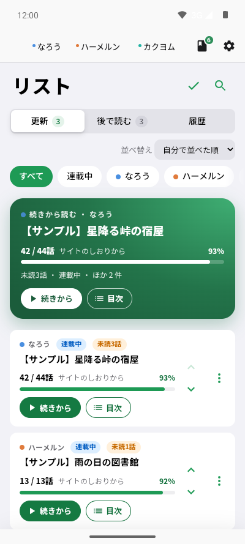
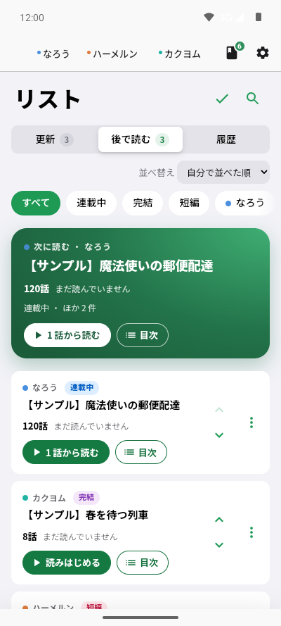
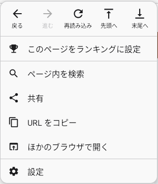
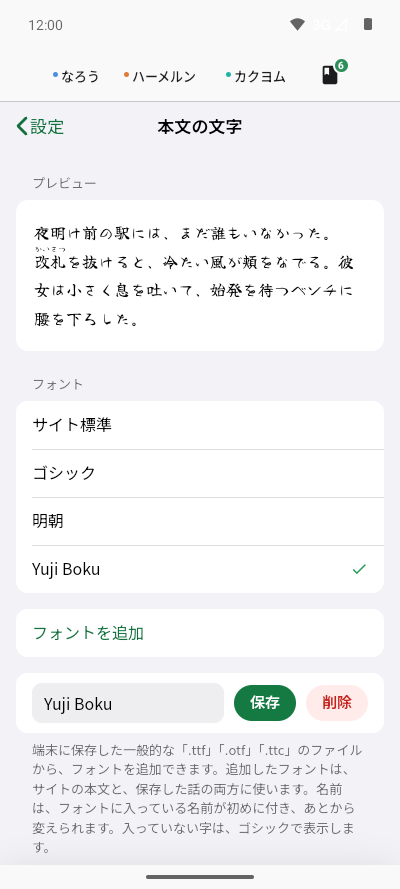
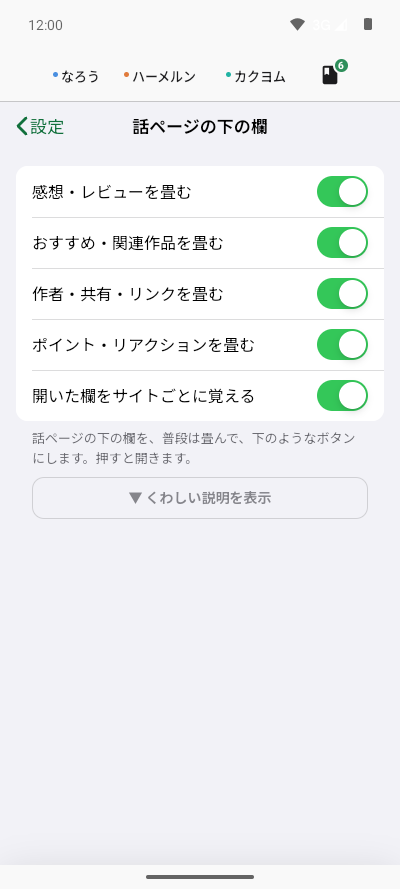
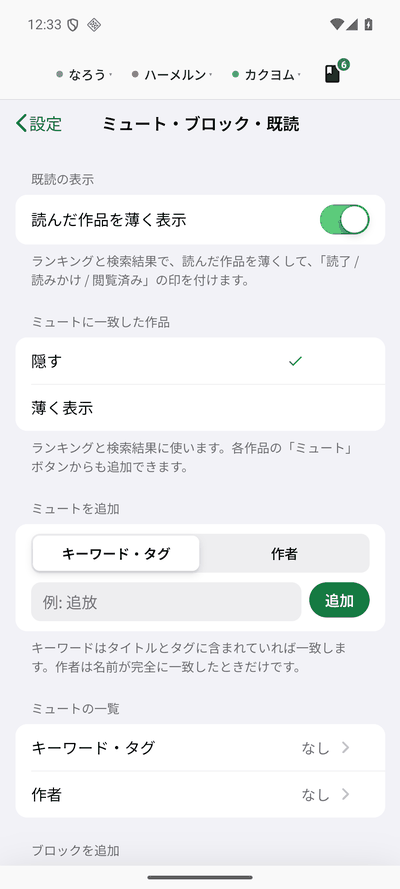
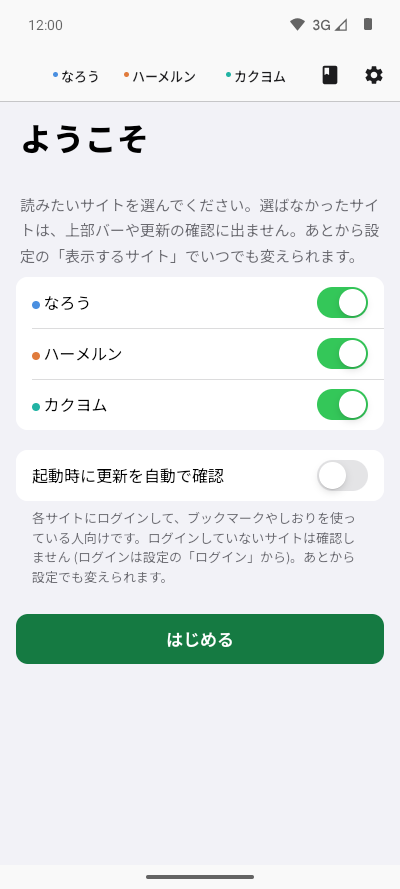
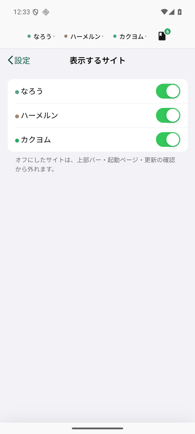
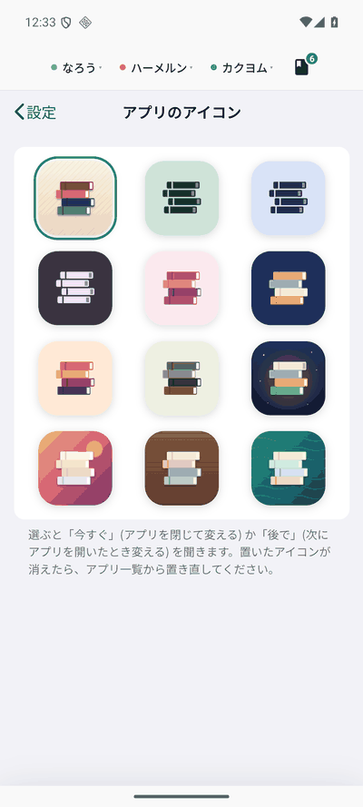

# ヨミクラ (Yomikura)

小説家になろう・ハーメルン・カクヨムを読みやすくする、Android 用のアプリです。各サイトの非公式のアプリで、サイトの運営とは関係ありません。

「しおりに入れた作品の更新を知る」「後で読むをためる」「続きから読む」「通信なしで読めるよう端末に保存する」を、サイトをまたいで 1 か所でできます。

<table><tr><td align="center"><br><sub>更新</sub></td><td align="center"><br><sub>後で読む</sub></td><td align="center"><br><sub>⋮ メニュー</sub></td></tr></table>

## できること

- **リスト**: 「更新」(しおり・フォローから取り込んだ未読)・「後で読む」・「履歴」の 3 つのタブ。検索、並べ替え、絞り込み、メモ・タグ (1 作品に複数)、読了の管理ができます。連載中・完結・短編と読み具合 (「12 / 120話」) が一目で分かり、連載の作品は「続きから」と「目次」を選べます。
- **履歴**: 読んだ作品を日付ごとに並べます。長編は、日ごとに読んだ話 (「5〜7話」など) も見られます。
- **更新の確認**: なろうのブックマーク、ハーメルンのしおり、カクヨムのフォローから、新しい話を確認します。アプリを閉じていても、決まった時刻に確認して通知できます。確認画面が出たサイトは、画面に出してご自身で通せます。
- **続きから読む**: 話ごとの読書位置を覚えて、リストの一番上から続きを開けます。話の最後には「次の小説へ」が出ます。
- **オフライン保存**: 作品を端末に保存して、通信なしで読めます (縦書き対応)。保存はアプリの裏で進み、途中で止まっても、次にアプリを開いたときに続きから保存します。
- **保存した話の見た目**: 本文の特殊文字や特殊表現なども保存できます。なろう・ハーメルンの挿絵も保存できます。ダークテーマでは、色の明るさを反転します。保存するのは、この決まった範囲の書き方だけです (外部へのリンクや、スクリプト・Web フォントは文字だけになります)。
- **新しい話を自動で保存** (設定 → オフライン保存、初期はオフ): 更新の確認で新しい話が出た保存済みの作品に、保存していない話を Wi-Fi のときに追加で保存します。
- **読み上げ**: 本文を端末の音声合成で読み上げます。画面を消しても続き、通知とロック画面から一時停止・再開・停止ができます。
- **ミュートとブロック**: 作者・タグ・キーワードで、ランキング・検索結果・トップ・作者ページの作品を隠したり薄くしたりできます。
- **読みやすさ**: 本文のフォント (一般的な「.ttf」「.otf」「.ttc」を追加できる。サイトの本文にも、保存した話にも使う。くわしくは [docs/accessibility.md](docs/accessibility.md))・文字サイズ・行間、ライト / ダーク、縦書き。読書ページではサイトのヘッダー・フッターとアプリへの誘導を隠します (トップ・一覧・作者ページではヘッダー・フッターを出します)。「感想・レビュー」「おすすめ・関連作品」「作者・共有・リンク」「ポイント・リアクション」の欄は、読書ページでは畳んであり、「▼ …を表示」のボタンで開けます (設定の「話ページの下の欄」で選べます)。
- **アプリのアイコン**: 積んだ本の絵を、12 種から選べます。
- **ほかのアプリから**: 共有した URL やリンクを開くと、作品を「後で読む」に追加できます。

<table><tr><td align="center"><br><sub>本文の文字</sub></td><td align="center"><br><sub>話ページの下の欄</sub></td><td align="center"><br><sub>ミュート</sub></td></tr></table>

## インストール

1. [最新のリリース](../../releases/latest) から、APK をダウンロードします (過去の版は [Releases](../../releases) にあります)。
2. Android の設定で、ブラウザやファイルアプリからのインストールを許可して、APK を開きます (「提供元不明のアプリ」の許可が要ります)。
3. 初回の画面で、読みたいサイトを選びます。

Android 8.0 (API 26) 以上が必要です。Google Play には公開していません。

<table><tr><td align="center"><br><sub>初回の画面</sub></td><td align="center"><br><sub>表示するサイト</sub></td><td align="center"><br><sub>アプリのアイコン</sub></td></tr></table>

## 使い方の目安

1. 各サイトに、アプリの中でログインします (設定 → サイト → ログイン)。しおり・フォローを使うときだけ必要です。ログインの状態は Cookie の有無だけを見て (中身や、パスワード・メールアドレスは読みません)、外へ送ることもありません。
2. リストの「更新を確認」を押すと、しおり・フォローの未読を取り込みます。
3. 読みたい作品は、ランキングや検索結果の「＋ 後で読む」でためます。
4. 作品のページの ⋮ メニューの「この作品をオフライン保存」で保存します。

## 守ってほしいこと

- 各サイトの利用規約を守って使ってください。アプリは、サイトに負担をかけないよう、アクセスの間隔をあけ、アクセス制限や確認画面が出たらそのサイトを休みます。確認画面を自動で通すことはしません。
- 作品の著作権は、作者とサイトにあります。端末に保存した本文は、ご自身が読む目的だけに使ってください。再配布はしないでください。

## プライバシー

- リスト・履歴・設定・保存した作品は、端末の中だけに置きます。開発者のサーバーへ送ることはなく、利用状況の収集もしません。
- アプリが自分でインターネットにつなぐのは、あなたが読む小説サイトと、アプリの更新を確かめるときだけです。サイトのページに載っている広告などは、ふつうのブラウザと同じように、そのページが読み込みます。それ以外の場所へ、アプリがデータを送ることはありません。広告などをタップして対応サイト以外のページへ移るときは、初めは端末のブラウザで開きます (設定 → 対応サイト以外のリンク で、ヨミクラの中で開くようにも変えられます)。

## 不具合を報告するには

1. アプリの 設定 → 診断情報 → 「診断情報をコピー」を押します。版・端末・設定の要約・データの件数・直近のエラーだけがコピーされます。作品名・URL・ログイン情報・メモは入りません。外へは送られず、コピーするだけです。
2. [Issues](../../issues) で「New issue」を押し、次のことを書いて、1. の診断情報を貼り付けます。
   - 何をしたら、どうなったか (どうなるはずだったか)
   - どのサイトのどのページか (表示が崩れたときは、ページの URL)
3. サイトの表示が崩れたときは、そのページの ⋮ メニューの「このページの表示を診断」を押すと、どの部分が見つからなくなったかが分かります。結果も書いてもらえると、直しやすくなります。

画面のスクリーンショットを付けるときは、作品名やアカウントが写っていないか確かめてください。

## ビルド

JDK 17 以上と Android SDK (compileSdk 36) が必要です。

```
./gradlew assembleOssDebug      # 開発用 (パッケージ名 com.tonbo2339.yomikura.debug)
./gradlew assembleOssRelease    # リリース版 (R8 で縮小。署名の鍵が無いと失敗します)
./gradlew testOssDebugUnitTest  # Kotlin の単体テスト
for f in app/src/test/js/*.test.mjs; do node "$f" 2>&1 | grep -q "^FAIL" && echo "FAIL $f"; done   # JS の単体テスト (Node 22 で確認。失敗しても終了コードは 0 なので、出力の FAIL を見る)
```

サイトの作りが変わって表示が崩れたら、まず `app/src/main/assets/js/site/sites.js` (サイトごとの CSS のセレクターを集めたファイル) を直してください。

## ライセンス

[GNU General Public License v3.0](LICENSE) です。改造した版を配るときも、同じライセンスでソースを公開してください。

## その他の設定

年齢に関わる設定は [docs/adult.md](docs/adult.md) にまとめてあります。
サイトへのアクセスのしかた (間隔・止められたときの休み方) は [docs/access.md](docs/access.md) にまとめてあります。
文字の大きさ・テーマ・読み上げなど、見えかたや操作のしやすさに関わる設定は [docs/accessibility.md](docs/accessibility.md) にまとめてあります。
なろうの 2 段階認証のコードを自動で入力する設定 (認証アプリの登録のしかたを含む) は [docs/2fa-login.md](docs/2fa-login.md) にまとめてあります。
