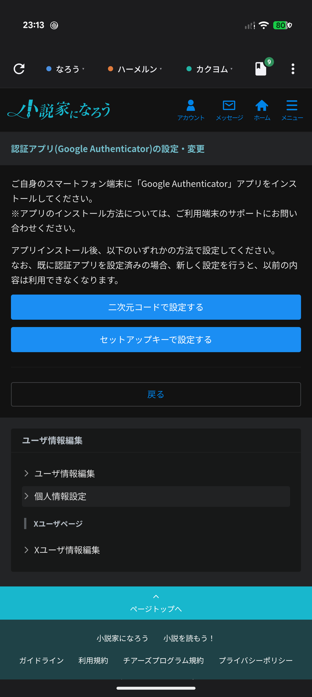
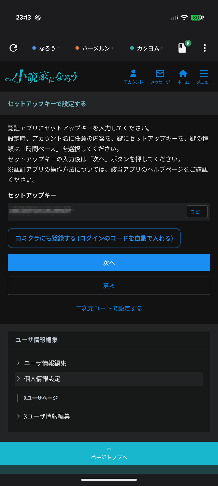
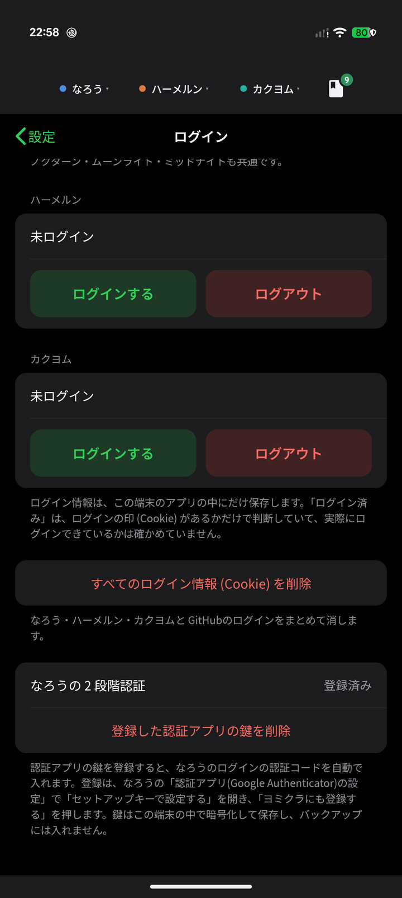

# なろうの 2 段階認証を自動で入力する

小説家になろうの 2 段階認証の「認証アプリ」のコードを、ヨミクラが代わりに入力します。ログインのたびに Authenticator アプリを開く手間がなくなります。

- パスワードは、スマホのパスワードマネージャーなどで入れてください。ヨミクラはパスワードを預かりません。
- 今までの Authenticator アプリも、そのまま使えます (同じ鍵を両方に登録します)。
- 登録は 1 回だけです。

**サイトの運営とは関係のない、非公式のアプリです。** 2 段階認証の設定は、なろうの画面でご自身が行います。ヨミクラは、その鍵を端末に保管して、コードの入力を手伝うだけです。

## 登録のしかた

ヨミクラの中で、なろうにログインしたまま行います。

1. なろうの「ユーザ情報編集」→「個人情報設定」→「二段階認証の設定」→「認証アプリ(Google Authenticator)の設定」を開きます。
2. 「**セットアップキーで設定する**」を押します。二次元コードの方ではありません。
   - すでに認証アプリを設定している場合、新しく設定すると、以前の内容は使えなくなります。このあとの手順で、同じ鍵を認証アプリにも入れ直します。

3. 画面にセットアップキー (英数字 16 文字ほど) が出ます。その下の「**ヨミクラにも登録する**」を押します。「登録しました」と出れば成功です。

キーは、人に見せないでください (画像のキーはモザイクをかけてあります)。
4. **同じキーを、認証アプリにも登録します。** 画面の「コピー」でキーをコピーしておくと楽です。
   - Google Authenticator の場合: アプリを開いて「＋」→「セットアップ キーを入力」を選び、アカウント名に好きな名前 (例: なろう)、キーにコピーしたキーを入れ、種類は「**時間ベース**」にして「追加」を押します。
   - ほかの認証アプリ (Microsoft Authenticator・Authy・1Password など) でも、同じ時間ベース (TOTP) のコードを作れるアプリなら使えます。「手動で入力」「セットアップキー」などの項目から、同じように登録します。
5. なろうの画面に戻って「次へ」を押し、認証アプリに出ている **6 桁のコード**を入力して、設定を完了します。

「ヨミクラにも登録する」を押さずに設定を終えた場合は、もう一度「セットアップキーで設定する」を開き直すと、新しいキーが出ます (そのあと 3〜5 をやり直してください)。

登録できたかは、ヨミクラの設定の「ログイン」で、「なろうの 2 段階認証: **登録済み**」と出ているかで確かめられます。

## ログインのとき

1. なろうのログイン画面で、ID とパスワードを入れてログインします。
2. 「認証」の画面で、自動で「認証アプリで認証する」へ進みます。
3. 認証コードの入力画面で、6 桁のコードが自動で入って送信されます。

自動で進むのは、**1 回のログインにつき 1 回だけ**です。なろうの設定ページなどで、もう一度認証を求められたときも、同じように自動で入力します。コードが通らなかったときは、繰り返さずに止まります。そのときは、認証アプリのコードを手で入れるか、「戻る」でメールの認証を選んでください。

## 安全のために

- 鍵は、この端末の中で暗号化して保存します (Android Keystore。取り出せない鍵で守ります)。ヨミクラの設定のバックアップや、Android の自動バックアップには入りません。
- 認証コードを渡すのは、**なろうの 2 段階認証の入力画面のときだけ**です。ほかのページやサイトには、渡しません。
- 機種変更や入れ直しをすると、鍵は引き継がれません。もう一度、上の手順で登録してください。
- 鍵は、パスワードと同じくらい大事なものです。パスワードと同じ端末に置くと、2 段階認証の守りは弱くなります。自分だけが使う端末で使ってください。

## 鍵を消す・使わない

ヨミクラの設定の「ログイン」→「なろうの 2 段階認証」の「登録した認証アプリの鍵を削除」で消せます。消しても、なろうの設定は変わりません。そのあとのログインでは、認証コードを手で入れます。

## うまくいかないとき

- **コードが通らない**: 端末の時計がずれていると、コードが合いません。設定の日付と時刻を「自動」にしてください。
- **自動で進まない**: 登録済みか (設定の「ログイン」) を確かめてください。なろうの画面の作りが変わると、自動で進まなくなることがあります。そのときは手で入力できます。
- **「ヨミクラにも登録する」が出ない**: 「セットアップキーで設定する」の画面か確かめてください。二次元コードの画面には出ません。
